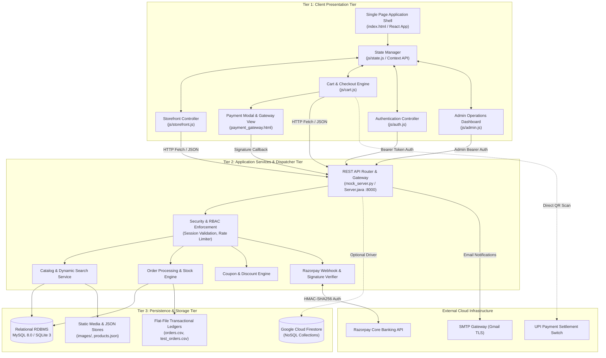
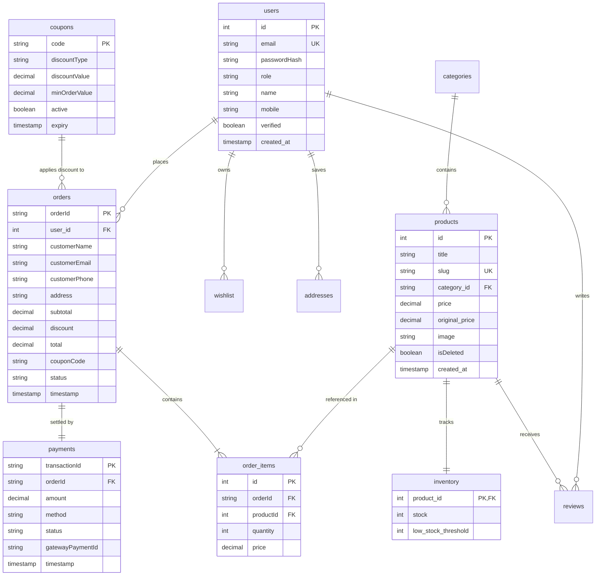
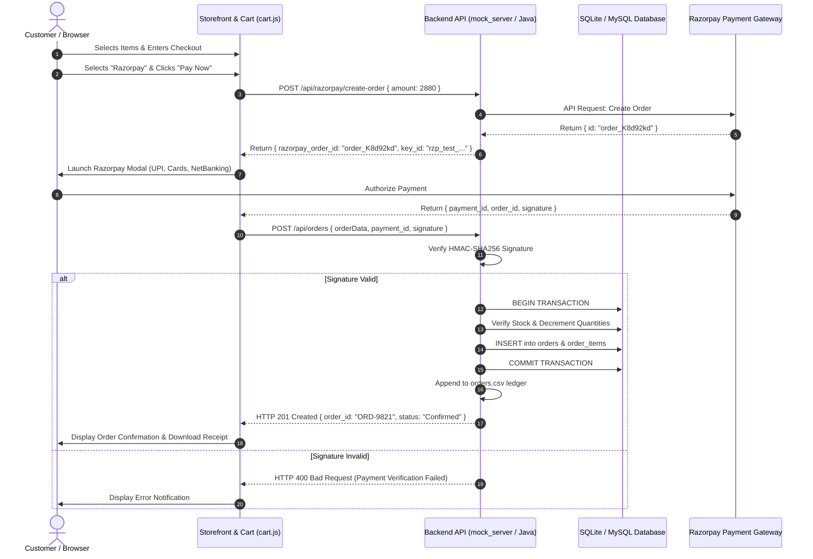
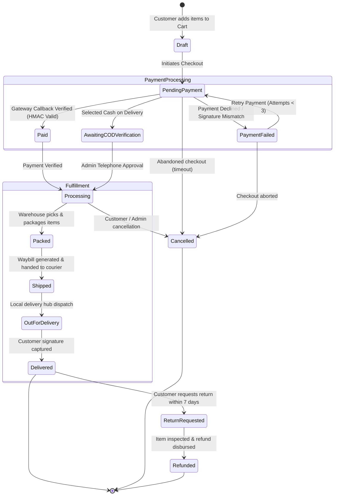

# 📖 SAI SANKALP E-COMMERCE PLATFORM
## Complete System Architecture, Engineering Specifications & Technical Documentation

---

> **Project Name:** Sai Sankalp (Artisan Crafts & Handloom E-Commerce Platform)  
> **Document Version:** 2.5.0  
> **Classification:** Comprehensive Technical Documentation & Architecture Manual  
> **Author:** Antigravity AI Engineering Architecture Team  
> **Last Updated:** November 2026  
> **Companion Deliverable:** [`Sai_Sankalp_All_8_UML_Diagrams.pdf`](file:///c:/Users/sameer%20marla/OneDrive/Documents/sai%20sankalp%20files%20updated/Sai_Sankalp_All_8_UML_Diagrams.pdf) *(10-page vector UML specification)*

---

## TABLE OF CONTENTS

1. [Executive Summary & Project Overview](#1-executive-summary--project-overview)
2. [High-Level Architecture & System Topology](#2-high-level-architecture--system-topology)
3. [Technology Stack](#3-technology-stack)
4. [Repository & Directory Structure](#4-repository--directory-structure)
5. [Frontend Architecture](#5-frontend-architecture)
   - 5.1 [Vanilla SPA Architecture (`sai_sankalp_website`)](#51-vanilla-spa-architecture-sai_sankalp_website)
   - 5.2 [Modular JavaScript Subsystems (`js/`)](#52-modular-javascript-subsystems-js)
   - 5.3 [Design System & CSS3 Polish (`styles.css`)](#53-design-system--css3-polish-stylescss)
   - 5.4 [Modern React + TypeScript Architecture (`bolt_project`)](#54-modern-react--typescript-architecture-bolt_project)
6. [Backend Architecture](#6-backend-architecture)
   - 6.1 [Python REST Service (`mock_server.py`)](#61-python-rest-service-mock_serverpy)
   - 6.2 [Java Native Embedded HTTP Server (`Server.java`)](#62-java-native-embedded-http-server-serverjava)
   - 6.3 [Firebase / Firestore Cloud Integration](#63-firebase--firestore-cloud-integration)
7. [Database Architecture & Data Persistence](#7-database-architecture--data-persistence)
   - 7.1 [Relational Database Schema (MySQL / SQLite)](#71-relational-database-schema-mysql--sqlite)
   - 7.2 [Data Dictionary & Table Specifications](#72-data-dictionary--table-specifications)
   - 7.3 [Flat-File Dual Persistence & CSV Audit Ledgers](#73-flat-file-dual-persistence--csv-audit-ledgers)
8. [REST API Specification](#8-rest-api-specification)
   - 8.1 [Authentication & Session Endpoints](#81-authentication--session-endpoints)
   - 8.2 [Product Catalog Endpoints](#82-product-catalog-endpoints)
   - 8.3 [Checkout & Payment Endpoints](#83-checkout--payment-endpoints)
   - 8.4 [Order & Fulfillment Endpoints](#84-order--fulfillment-endpoints)
   - 8.5 [Utility & Administrative Endpoints](#85-utility--administrative-endpoints)
9. [Security Architecture & Hardening](#9-security-architecture--hardening)
   - 9.1 [Authentication & Session Security (RBAC)](#91-authentication--session-security-rbac)
   - 9.2 [Rate Limiting & Brute-Force Defense](#92-rate-limiting--brute-force-defense)
   - 9.3 [Path Traversal & Static Asset Whitelisting](#93-path-traversal--static-asset-whitelisting)
   - 9.4 [Cross-Origin Resource Sharing (CORS) Isolation](#94-cross-origin-resource-sharing-cors-isolation)
   - 9.5 [Price Tampering Prevention & HMAC Webhooks](#95-price-tampering-prevention--hmac-webhooks)
10. [Payment Processing Engine](#10-payment-processing-engine)
    - 10.1 [Razorpay Payment Gateway Pipeline](#101-razorpay-payment-gateway-pipeline)
    - 10.2 [Direct UPI Dynamic QR Flow](#102-direct-upi-dynamic-qr-flow)
    - 10.3 [Cash on Delivery (COD) Workflow](#103-cash-on-delivery-cod-workflow)
11. [Order Fulfillment & State Machine Lifecycle](#11-order-fulfillment--state-machine-lifecycle)
12. [Administrative Operations & Telemetry](#12-administrative-operations--telemetry)
13. [Testing, Quality Assurance & Verification](#13-testing-quality-assurance--verification)
    - 13.1 [Comprehensive Regression Test Suite (`regression_test.py`)](#131-comprehensive-regression-test-suite-regression_testpy)
    - 13.2 [Security Hardening Verification (`verify_security_hardening.py`)](#132-security-hardening-verification-verify_security_hardeningpy)
14. [UML Diagrams & Architectural Traceability](#14-uml-diagrams--architectural-traceability)
15. [Installation, Setup & Deployment Guide](#15-installation-setup--deployment-guide)

---

## 1. EXECUTIVE SUMMARY & PROJECT OVERVIEW

**Sai Sankalp** is an enterprise-grade multi-channel e-commerce platform developed specifically for marketing and distributing authentic handmade artisan crafts, handloom textiles, spiritual artifacts, and sustainable lifestyle goods. The platform addresses the full commerce lifecycle: customer discovery, dynamic filtering, real-time client-side cart synchronization, promotional discounting, multi-mode payment settlement, and back-office order fulfillment.

### Primary Objectives & Capabilities:
- **Artisan Discovery:** Showcase regional handicrafts with high-resolution imagery, artisan biographical profiles, category classification, dynamic search, price slider filtering, and stock availability badges.
- **Resilient Checkout:** Frictionless multi-step checkout supporting three independent payment paths: **Razorpay Payment Gateway** (Credit/Debit Cards, NetBanking, Wallets), **Direct UPI QR** scanning with transaction reference verification, and **Cash on Delivery (COD)**.
- **Enterprise Dual-Backend Flexibility:** Operates seamlessly on either a high-performance **Java embedded HTTP server (`Server.java`)** or a production-hardened **Python backend (`mock_server.py`)** with MySQL/SQLite persistence, plus an optional **Google Cloud Firestore** NoSQL adapter.
- **Dual-Storage Resilience:** Combines transactional relational databases (`saisankalp.db` / MySQL `saisankalp`) with flat-file CSV transactional ledgers (`orders.csv`, `test_orders.csv`) ensuring zero data loss during network partition or database maintenance.
- **Administrative Operations:** Comprehensive single-page admin dashboard providing inventory adjustments, price updates, order dispatch status transitions, promotional coupon creation, banner carousels, and audit log generation.
- **Dual-Frontend Implementations:** Features both a battle-tested **Vanilla JavaScript (ES6+) Single Page Application** with zero external frontend runtime dependencies and a modern **React 18 + TypeScript + Vite + Tailwind CSS** progressive web application.

---

## 2. HIGH-LEVEL ARCHITECTURE & SYSTEM TOPOLOGY

The Sai Sankalp platform implements a decoupled **Layered Model-View-Controller (MVC)** architectural pattern with event-driven client state synchronization.



---

## 3. TECHNOLOGY STACK

| Layer | Component | Technologies / Libraries | Purpose |
|:---|:---|:---|:---|
| **Presentation (Vanilla)** | SPA Shell | HTML5, CSS3, JavaScript (ES6+ Vanilla) | Zero-dependency, ultra-fast client interface |
| **Presentation (Modern)** | SPA Framework | React 18, TypeScript 5.5, Vite 5.4 | Component-based modern UI alternative |
| **Styling & UI Polish** | Design Engine | Tailwind CSS 3.4, Custom CSS3 Variables, FontAwesome 6 | Responsive typography, dark mode, animations |
| **Icons & Assets** | Media | Lucide React, FontAwesome 6 Free, WebP/PNG Assets | Iconography and optimized asset rendering |
| **Backend (Python)** | Web Server | Python 3.11, `http.server`, WSGI, Flask | Primary production API runtime & mock service |
| **Backend (Java)** | Web Server | Java 17+, `com.sun.net.httpserver` | High-throughput native embedded HTTP daemon |
| **Database (Primary)** | Relational | MySQL 8.0 / SQLite 3 (`saisankalp.db`) | ACID-compliant relational data persistence |
| **Database (Cloud)** | Cloud NoSQL | Google Cloud Firestore (via Firebase Admin SDK) | Cloud database migration & synchronization |
| **Audit Ledger** | Flat-File | RFC 4180 CSV (`orders.csv`, `test_orders.csv`) | Immutable append-only audit trail |
| **Payment Gateway** | FinTech | Razorpay Payment Gateway API, UPI VPA Network | Card, NetBanking, and UPI payment processing |
| **Security & Crypto** | Security | HMAC SHA-256, Bcrypt, PBKDF2, CSP Headers | Encryption, password hashing, and anti-tamper |
| **Testing & QA** | Verification | Python `urllib`, Custom Regression Test Runner | 93-point automated integration & security suite |
| **Build & Orchestration** | DevOps | PowerShell 7 (`run.ps1`), Batch (`run_project.bat`) | One-click service initialization and compilation |

---

## 4. REPOSITORY & DIRECTORY STRUCTURE

```
sai sankalp files updated/
├── SAI_SANKALP_PROJECT_DOCUMENTATION.md      # Master technical documentation (this file)
├── Sai_Sankalp_All_8_UML_Diagrams.pdf        # Official 10-page vector UML diagrams deliverable
├── generate_uml_pdf.py                      # Standalone Python UML diagram generator script
├── run_project.bat                          # Root Windows batch execution script
├── sai_sankalp_audit_report.md              # Full-stack architectural security audit findings
├── remediation_and_firebase_migration_plan.md# Security hardening & Firestore roadmap
│
├── uml_diagrams_preview/                    # High-resolution 2K PNG previews of all diagrams
│   ├── 00_cover_page.png
│   ├── 01_class_diagram.png
│   ├── 02_use_case_diagram.png
│   ├── 03_sequence_diagram.png
│   ├── 04_collaboration_diagram.png
│   ├── 05_activity_diagram.png
│   ├── 06_state_chart_diagram.png
│   ├── 07_component_diagram.png
│   ├── 08_deployment_diagram.png
│   └── 09_traceability_matrix.png
│
├── sai sankalp files/
│   └── sai_sankalp_website/                 # PRIMARY PRODUCTION WEB APPLICATION
│       ├── index.html                       # Main customer & admin SPA entrypoint (1,453 lines)
│       ├── styles.css                       # Global responsive stylesheet & animations (3,200 lines)
│       ├── app.js                           # Frontend controller & coordinator (1,789 lines)
│       ├── payment_gateway.html             # Standalone payment testing & mock gateway modal
│       ├── config.properties                # Java server runtime properties
│       ├── .env                             # Environment variables & secrets (ignored in Git)
│       ├── .env.example                     # Reference template for configuration variables
│       │
│       ├── js/                              # MODULAR JAVASCRIPT SUBSYSTEMS
│       │   ├── state.js                     # Global reactive state, event bus & fetch interceptor
│       │   ├── storefront.js                # Product grid, categories, search, filtering & hero
│       │   ├── cart.js                      # Cart drawer, calculations, taxes, discount & checkout
│       │   ├── auth.js                      # User login, registration, OTP validation & profile
│       │   └── admin.js                     # Admin dashboard, product CRUD, order dispatcher
│       │
│       ├── Server.java                      # Java embedded HTTP server daemon (2,316 lines)
│       ├── mock_server.py                   # Python HTTP API & business logic server (1,841 lines)
│       ├── db_config.py                     # MySQL connection manager & auto-provisioning
│       ├── env_loader.py                    # Dotenv parser without external dependencies
│       ├── firebase_manager.py              # Cloud Firestore CRUD & Firebase Admin connector
│       ├── migrate_to_firebase.py           # Database migration CLI script
│       ├── firestore.rules                  # Security rules for Cloud Firestore
│       ├── regression_test.py               # 93-case automated test suite (590 lines)
│       ├── verify_security_hardening.py     # Post-hardening verification script (222 lines)
│       ├── generate_docs.py                 # Automated document generation script
│       ├── run.ps1                          # PowerShell startup automation
│       │
│       ├── data/                            # STORAGE & PERSISTENCE ASSETS
│       │   ├── saisankalp.db                # SQLite database (135 KB, 7 relational tables)
│       │   ├── orders.csv                   # Immutable transactional ledger (4.3 KB)
│       │   ├── test_orders.csv              # Test order audit log
│       │   ├── products.json                # Seed catalog data (6 active products)
│       │   ├── categories.json              # Category metadata
│       │   ├── coupons.json                 # Promotional coupon rules
│       │   ├── banners.json                 # Hero carousel configuration
│       │   └── users.json                   # User credential seeds
│       │
│       └── images/                          # Media repository (product photos, hero banners)
│
└── bolt_project/
    └── project/                             # MODERN REACT + TYPESCRIPT IMPLEMENTATION
        ├── package.json                     # NPM dependencies (React 18, Vite, Tailwind, Supabase)
        ├── vite.config.ts                   # Vite bundler configuration
        ├── tailwind.config.js               # Tailwind design system configuration
        ├── tsconfig.json                    # TypeScript compiler configuration
        ├── src/
        │   ├── App.tsx                      # Root component & client-side router
        │   ├── main.tsx                     # React DOM entrypoint
        │   ├── index.css                    # Tailwind utility injections
        │   ├── components/                  # Navbar, Footer, CartDrawer, ToastContainer
        │   ├── context/                     # CartContext, AuthContext, ToastContext, RouterContext
        │   ├── pages/                       # HomePage, ShopPage, ProductDetailPage, CartPage,
        │   │                                # CheckoutPage, AdminLoginPage, AdminDashboardPage
        │   ├── types/                       # TypeScript interfaces for Product, Order, User
        │   └── lib/                         # Supabase & Firebase client SDK configurations
        └── supabase/
            └── migrations/                  # PostgreSQL database migration scripts
```

---

## 5. FRONTEND ARCHITECTURE

The platform features two distinct frontends targeting different operational requirements:

### 5.1 Vanilla SPA Architecture (`sai_sankalp_website`)
The primary web storefront is constructed using standard semantic HTML5, modern CSS3, and ES6+ JavaScript. By avoiding client-side framework overhead (such as React or Angular runtime loading), the initial bundle delivers sub-second First Contentful Paint (FCP) and optimal lighthouse performance on low-bandwidth mobile connections.

#### Core Page Structure (`index.html`):
1. **Glassmorphism Header & Navigation:** Sticky top navigation bar with brand logo, category shortcuts, search input with live debouncing, wishlist counter, and cart badge.
2. **Hero Banner Carousel:** Responsive promotional banner displaying artisan highlights, rotating via timer and touch-swipe gestures.
3. **Filter & Refinement Drawer:** Collapsible sidebar supporting multi-category checkboxes, artisan/brand checkboxes, dual-handle price range slider, and an "In-Stock Only" toggle.
4. **Responsive Product Grid:** Staggered card layout with hover zoom effects, sale discount badges, star ratings, and "Add to Cart" CTA buttons.
5. **Interactive Shopping Cart Drawer:** Off-canvas sliding drawer (`translateX`) displaying active line items, quantity adjustment controls, line item deletion, coupon input, subtotal, GST calculation, and checkout trigger.
6. **Multi-Step Checkout Modal:** Tabbed interface supporting shipping address input, coupon code validation, and payment method selection (Razorpay, UPI QR, COD).
7. **Customer & Admin Dashboards:** Dedicated views for customer order history/invoices and administrative catalog management.
8. **Toast Notification Stack:** Non-blocking floating alerts for feedback (`#toastContainer`).

---

### 5.2 Modular JavaScript Subsystems (`js/`)

The JavaScript codebase is cleanly split across 5 dedicated domain modules coordinated by [`app.js`](file:///c:/Users/sameer%20marla/OneDrive/Documents/sai%20sankalp%20files%20updated/sai%20sankalp%20files/sai_sankalp_website/app.js):

```
+---------------------------------------------------------------------------------+
|                                app.js (Orchestrator)                            |
+---------┬-------------------┬-------------------┬-------------------┬-----------+
          │                   │                   │                   │
          ▼                   ▼                   ▼                   ▼
  +---------------+   +---------------+   +---------------+   +---------------+
  |    state.js   |   | storefront.js |   |    cart.js    |   |    auth.js    |
  | Global State  |   | Catalog & Grid|   | Cart & Checkout|  | Login & RBAC  |
  | Interceptors  |   | Dynamic Filter|   | Coupon Engine |   | OTP Handlers  |
  +---------------+   +---------------+   +---------------+   +---------------+
          ▲                                                           │
          └───────────────────────────┬───────────────────────────────┘
                                      ▼
                              +---------------+
                              |    admin.js   |
                              | CRUD Dashboard|
                              | Order Dispatch|
                              +---------------+
```

#### 1. [`js/state.js`](file:///c:/Users/sameer%20marla/OneDrive/Documents/sai%20sankalp%20files%20updated/sai%20sankalp%20files/sai_sankalp_website/js/state.js) — Reactive State & Interceptor
- Implements a centralized publish-subscribe pattern with `APP_STATE`.
- Contains `safeFetch()` wrapper that automatically injects `Authorization: Bearer <token>` and `X-CSRF-Token` headers into outbound REST calls.
- Provides XSS sanitization via `escapeHtml(str)` ensuring untrusted input is escaped prior to DOM interpolation.

#### 2. [`js/storefront.js`](file:///c:/Users/sameer%20marla/OneDrive/Documents/sai%20sankalp%20files%20updated/sai%20sankalp%20files/sai_sankalp_website/js/storefront.js) — Catalog & Presentation Engine
- Manages product catalog rendering (`renderProducts()`), client-side filtering (`filterAndSortProducts()`), and search debouncing (300ms delay).
- Dynamically generates product cards with fallback image placeholders and stock badge calculations.
- Synchronizes customer wishlist items with server state.

#### 3. [`js/cart.js`](file:///c:/Users/sameer%20marla/OneDrive/Documents/sai%20sankalp%20files%20updated/sai%20sankalp%20files/sai_sankalp_website/js/cart.js) — Shopping Cart & Checkout Controller
- Manages the in-memory cart array with persistent `localStorage` synchronization.
- Calculates financial line totals: Subtotal, CGST (9%), SGST (9%), flat shipping fee calculations, and coupon deductions.
- Handles checkout modal lifecycle, payment tab switching (`switchPaymentMethod()`), and COD order placement.

#### 4. [`js/auth.js`](file:///c:/Users/sameer%20marla/OneDrive/Documents/sai%20sankalp%20files%20updated/sai%20sankalp%20files/sai_sankalp_website/js/auth.js) — Identity & Session Manager
- Handles customer registration, login credentials submission, and logout session teardown.
- Implements email OTP verification workflows for account confirmation and password reset.
- Evaluates user roles (`admin` vs `customer`) to dynamically toggle administrative navigation links.

#### 5. [`js/admin.js`](file:///c:/Users/sameer%20marla/OneDrive/Documents/sai%20sankalp%20files%20updated/sai%20sankalp%20files/sai_sankalp_website/js/admin.js) — Back-Office Dashboard
- Renders administrative inventory management tables with inline stock editing and product creation forms.
- Manages order fulfillment workflows: view order details, update status (`Shipped`, `Delivered`, `Cancelled`), and trigger tracking emails.
- Provides business analytics summaries: total revenue, order volume, and low-stock alerts.

---

### 5.3 Design System & CSS3 Polish (`styles.css`)

The styling architecture encompasses 3,200 lines of modern, responsive CSS organized using custom design tokens:

```css
:root {
    --primary-color: #D36E50;       /* Terracotta / Artisan Clay */
    --primary-dark: #B55438;
    --accent-color: #F4A261;        /* Warm Sunset Amber */
    --secondary-color: #264653;     /* Deep Slate Marine */
    --text-primary: #2B2D42;        /* Dark Charcoal */
    --text-secondary: #6C757D;      /* Medium Muted Gray */
    --bg-primary: #FFFFFF;
    --bg-secondary: #F8F9FA;
    --border-color: #E9ECEF;
    --card-shadow: 0 4px 12px rgba(0, 0, 0, 0.08);
    --transition-smooth: all 0.3s cubic-bezier(0.25, 0.8, 0.25, 1);
}
```

#### Key Visual Polish Features:
- **Dark Mode Support:** `@media (prefers-color-scheme: dark)` variable overrides for backgrounds, text, and modals.
- **Glassmorphism Navbar:** `backdrop-filter: blur(12px)` with semi-transparent frosted styling on scroll.
- **Micro-Interactions:** Subtle card image scale (1.08x) on hover, pulsing stock warning badges, and button box-shadow glows.
- **Loading Skeletons:** Animated CSS shimmer gradients (`@keyframes shimmer`) displayed while fetching remote catalog items.
- **Mobile-Responsive Breakpoints:** Flexible media queries optimizing layouts for mobile (<768px), tablet (768px–1024px), and desktop (>1024px) screens.

---

### 5.4 Modern React + TypeScript Architecture (`bolt_project`)

The `bolt_project` directory houses an optional modernization of the platform built on **React 18**, **TypeScript**, and **Tailwind CSS**, bundled via **Vite**:

- **Context API State Layer:** Split across `CartContext`, `AuthContext`, `ToastContext`, and `RouterContext`.
- **Component Hierarchy:** Modular components (`Navbar`, `Footer`, `CartDrawer`, `ProductCard`, `ToastContainer`).
- **Type Safety:** Comprehensive TypeScript models defining `Product`, `OrderItem`, `OrderMaster`, `UserSession`, and `CouponRule`.
- **Backend Portability:** Preconfigured Supabase Client (`@supabase/supabase-js`) and Firebase SDK (`firebase/firestore`) integration points for serverless hosting.

---

## 6. BACKEND ARCHITECTURE

Sai Sankalp includes two production-grade backend implementations sharing identical RESTful API contracts:

### 6.1 Python REST Service (`mock_server.py`)
A self-contained Python WSGI/HTTP server based on `http.server` (1,841 lines) engineered for high maintainability with zero heavy external dependencies.

```
+-------------------------------------------------------------------------------+
|                      mock_server.py (Python Backend Engine)                   |
+---------------------------------------┬---------------------------------------+
                                        │
    ┌───────────────────────────────────┼───────────────────────────────────┐
    ▼                                   ▼                                   ▼
+---------------------+     +---------------------+     +---------------------+
|   Database Layer    |     |   Security Filters  |     |   Third-Party APIs  |
| - db_config.py      |     | - RateLimiter       |     | - Razorpay Client   |
| - SQLite / MySQL    |     | - SessionValidator  |     | - SMTP Mailer       |
| - CSV Ledger Writer |     | - CORS Filter       |     | - OTP Engine        |
+---------------------+     +---------------------+     +---------------------+
```

#### Key Capabilities:
- **Database Abstraction:** Automatically interfaces with MySQL via `db_config.py` with automatic fallback to local SQLite (`saisankalp.db`).
- **Cryptographic Token Verification:** Implements 256-bit cryptographically secure session tokens generated via `secrets.token_hex(32)`.
- **HMAC Verification:** Uses timing-attack resistant `hmac.compare_digest` for validating incoming Razorpay payment signatures.
- **Auto-Provisioning:** Executes table schema creation on initialization if tables do not exist.

---

### 6.2 Java Native Embedded HTTP Server (`Server.java`)
An enterprise-grade Java backend (2,316 lines) built using the native Java Standard Library `com.sun.net.httpserver.HttpServer`.

#### Architectural Highlights:
- **Zero Third-Party Runtime Overhead:** Runs on standard JRE 17+ without requiring Apache Tomcat, Jetty, or Spring Boot containers.
- **Modular Handler Architecture:** Every endpoint is managed by a dedicated subclass implementing `HttpHandler`:
  - `Server$ProductsApiHandler`
  - `Server$OrdersApiHandler`
  - `Server$OrdersUpdateStatusHandler`
  - `Server$PaymentsInitiateHandler`
  - `Server$PaymentsWebhookHandler`
  - `Server$AuthLoginHandler`
  - `Server$AuthRegisterHandler`
  - `Server$AuthVerifyOtpHandler`
  - `Server$AuthForgotPasswordHandler`
  - `Server$StaticFileHandler`
- **Embedded SMTP Engine:** Includes `Server$SmtpClient` executing raw socket SMTP transactions over TLS to send branded transactional receipts and password-reset OTPs.
- **Thread Pooling:** Utilizes a configured `ThreadPoolExecutor` managing concurrent client requests.

---

### 6.3 Firebase / Firestore Cloud Integration

The platform includes a turn-key Google Cloud Firestore persistence suite:
- [`firebase_manager.py`](file:///c:/Users/sameer%20marla/OneDrive/Documents/sai%20sankalp%20files%20updated/sai%20sankalp%20files/sai_sankalp_website/firebase_manager.py): Object-document mapper implementing CRUD operations for 7 Firestore collections.
- [`migrate_to_firebase.py`](file:///c:/Users/sameer%20marla/OneDrive/Documents/sai%20sankalp%20files%20updated/sai%20sankalp%20files/sai_sankalp_website/migrate_to_firebase.py): Migration script extracting data from SQLite/JSON and seeding Firestore.
- [`firestore.rules`](file:///c:/Users/sameer%20marla/OneDrive/Documents/sai%20sankalp%20files%20updated/sai%20sankalp%20files/sai_sankalp_website/firestore.rules): Production security rules enforcing read/write restrictions based on user authentication claims.

---

## 7. DATABASE ARCHITECTURE & DATA PERSISTENCE

### 7.1 Relational Database Schema (MySQL / SQLite)

The platform utilizes a normalized relational schema composed of **15 core tables**:



---

### 7.2 Data Dictionary & Table Specifications

| Table Name | Primary Key | Foreign Keys | Key Columns | Purpose |
|:---|:---|:---|:---|:---|
| `users` | `id` (INT AUTO) | None | `email`, `passwordHash`, `role`, `verified`, `name`, `mobile` | User profiles, authentication hashes, and roles (`admin`, `customer`) |
| `categories` | `id` (VARCHAR) | None | `name`, `icon`, `description` | Product catalog taxonomies and iconography |
| `products` | `id` (INT AUTO) | `category_id` $\to$ `categories.id` | `title`, `slug`, `price`, `original_price`, `image`, `isDeleted` | Product specifications, pricing, and soft-delete status |
| `inventory` | `product_id` (INT) | `product_id` $\to$ `products.id` | `stock`, `low_stock_threshold` | Real-time stock counts and low-inventory warning triggers |
| `orders` | `orderId` (VARCHAR) | `user_id` $\to$ `users.id` | `customerEmail`, `subtotal`, `discount`, `total`, `status` | Master financial orders, fulfillment state, and addresses |
| `order_items` | `id` (INT AUTO) | `orderId` $\to$ `orders.orderId`, `productId` $\to$ `products.id` | `quantity`, `price` | Normalized line items for each customer order |
| `payments` | `transactionId` | `orderId` $\to$ `orders.orderId` | `amount`, `method`, `status`, `gatewayPaymentId` | Payment transaction records, settlement status, and gateway IDs |
| `coupons` | `code` (VARCHAR) | None | `discountType`, `discountValue`, `minOrderValue`, `active` | Promotional discount vouchers and eligibility rules |
| `reviews` | `id` (INT AUTO) | `productId` $\to$ `products.id` | `author`, `rating`, `comment`, `created_at` | Customer feedback and star ratings |
| `wishlist` | `id` (INT AUTO) | `productId` $\to$ `products.id` | `userEmail`, `productId` | Saved products for customer accounts |
| `addresses` | `id` (INT AUTO) | None | `userEmail`, `name`, `mobile`, `address`, `city`, `pincode` | Saved shipping destinations |
| `banners` | `id` (INT AUTO) | None | `image`, `title`, `subtitle`, `target_url`, `sort_order` | Hero carousel marketing assets |
| `notifications` | `id` (INT AUTO) | None | `title`, `message`, `type`, `isRead`, `timestamp` | System administrative alerts |
| `sessions` | `token` (VARCHAR) | None | `email`, `role`, `expires`, `csrfToken` | Active authenticated login sessions |
| `login_attempts`| `id` (INT AUTO) | None | `ip`, `email`, `attempts`, `last_attempt` | Brute-force rate limiting and lockout state |

---

### 7.3 Flat-File Dual Persistence & CSV Audit Ledgers

To safeguard against catastrophic database crashes or corruptions, the platform maintains a synchronized **dual-persistence pipeline**:
1. When an order is confirmed, it is inserted into the relational RDBMS inside an atomic transaction.
2. The server concurrently formats the order record into RFC 4180 compliant CSV and appends it to [`data/orders.csv`](file:///c:/Users/sameer%20marla/OneDrive/Documents/sai%20sankalp%20files%20updated/sai%20sankalp%20files/sai_sankalp_website/data/orders.csv):

```csv
Order ID,Date,Customer Name,Email,Phone,Address,Items,Subtotal,Discount,Total,Payment Method,Payment Status,Order Status
ORD-1726488200-883,2026-09-16 11:43:20,Aarav Sharma,aarav@example.com,9876543210,"Flat 402, Lotus Towers, Bangalore",Handloom Silk Saree (Qty: 1),3200.00,320.00,2880.00,Razorpay,Paid,Processing
```

---

## 8. REST API SPECIFICATION

The backend exposes a standardized RESTful JSON API binding port `8000`:

### 8.1 Authentication & Session Endpoints

| Method | Route | Access | Request Body | Success Response | Error Codes |
|:---|:---|:---|:---|:---|:---|
| `POST` | `/api/auth/register` | Public | `{ name, email, password, mobile }` | `201 Created` `{ message, requiresOtp: true }` | `400`, `409` |
| `POST` | `/api/auth/verify-otp` | Public | `{ email, otp }` | `200 OK` `{ message, verified: true }` | `400`, `401` |
| `POST` | `/api/auth/login` | Public | `{ email, password }` | `200 OK` `{ token, user: { name, email, role } }` | `401`, `429` |
| `POST` | `/api/auth/logout` | Authenticated | None (Bearer header) | `200 OK` `{ message: "Logged out" }` | `401` |
| `GET` | `/api/auth/session` | Authenticated | None (Bearer header) | `200 OK` `{ user: { name, email, role } }` | `401` |
| `POST` | `/api/auth/forgot-password` | Public | `{ email }` | `200 OK` `{ message: "OTP sent" }` | `404`, `429` |
| `POST` | `/api/auth/reset-password` | Public | `{ email, otp, newPassword }` | `200 OK` `{ message: "Password updated" }` | `400`, `401` |

---

### 8.2 Product Catalog Endpoints

| Method | Route | Access | Query Parameters | Request / Response Details |
|:---|:---|:---|:---|:---|
| `GET` | `/api/products` | Public | `category`, `search`, `sort`, `in_stock`, `page` | Returns `{ products: [...], total, page, limit }` |
| `GET` | `/api/products/:id` | Public | None | Returns single product record with stock & reviews |
| `POST` | `/api/products` | Admin Only | None | Body: `{ title, price, category, stock, image, description }` $\to$ Returns `201 Created` |
| `PUT` | `/api/products/:id` | Admin Only | None | Body: Partial product update $\to$ Returns `200 OK` |
| `DELETE`| `/api/products/:id` | Admin Only | None | Soft-deletes product (`isDeleted = 1`) $\to$ Returns `200 OK` |
| `GET` | `/api/categories` | Public | None | Returns list of all active categories and counts |

---

### 8.3 Checkout & Payment Endpoints

| Method | Route | Access | Description |
|:---|:---|:---|:---|
| `POST` | `/api/coupons/validate` | Public | Validates promo coupon against subtotal. Body: `{ code, subtotal }`. Returns `{ valid, discountAmount, finalTotal }`. |
| `POST` | `/api/razorpay/create-order` | Authenticated / Guest | Creates upstream Razorpay order. Body: `{ amount }`. Returns `{ razorpay_order_id, currency, key_id }`. |
| `POST` | `/api/razorpay/verify-payment`| Authenticated / Guest | Verifies HMAC-SHA256 signature. Body: `{ razorpay_order_id, razorpay_payment_id, razorpay_signature }`. Returns `{ verified: true }`. |
| `POST` | `/api/payments/webhook` | Webhook (Razorpay) | Captures asynchronous payment webhooks verified via webhook secret header. |

---

### 8.4 Order & Fulfillment Endpoints

| Method | Route | Access | Description |
|:---|:---|:---|:---|
| `POST` | `/api/orders` | Authenticated / Guest | Submits checkout order, verifies stock, decrements inventory, commits to database & CSV. |
| `GET` | `/api/orders` | Customer / Admin | Returns orders. Customers only see their own orders; Admins retrieve all system orders. |
| `PUT` | `/api/orders/update-status` | Admin Only | Updates order status (`Processing`, `Packed`, `Shipped`, `Delivered`, `Cancelled`). |
| `POST` | `/api/orders/customer-action` | Customer | Allows customer to request return or cancel before dispatch. |
| `POST` | `/api/orders/resend-email` | Admin Only | Triggers re-dispatch of order confirmation / invoice email to customer. |

---

## 9. SECURITY ARCHITECTURE & HARDENING

Following an exhaustive security audit, the platform was hardened against common enterprise web vulnerabilities:

### 9.1 Authentication & Session Security (RBAC)
- **Elimination of Header Trust:** Completely purged legacy `X-Admin-Email` trust vectors. Admin operations now strictly require a signed bearer token (`Authorization: Bearer <token>`) validated against active server-side sessions.
- **Modern Password Hashing:** Uses **Bcrypt** (and PBKDF2 with 10,000+ iterations) replacing insecure unsalted SHA-256 hashes.
- **Cryptographic Tokens:** Sessions use 256-bit entropy tokens (`secrets.token_hex(32)`) expiring after 24 hours of inactivity.

---

### 9.2 Rate Limiting & Brute-Force Defense
- **Login Defense:** IP and email addresses are tracked in `login_attempts`. If more than 5 failed login attempts occur within 15 minutes, the account is locked for a 15-minute cooldown period (`HTTP 429 Too Many Requests`).
- **OTP Protection:** Registration and password reset OTPs are capped at 3 validation attempts and expire in 10 minutes.

---

### 9.3 Path Traversal & Static Asset Whitelisting
To prevent unauthorized exfiltration of source code, configurations, or database files:
- The static file server strictly blocks requests targeting `.env`, `.db`, `.csv`, `.java`, `.py`, `.properties`, `.json`, or `__pycache__`.
- Only explicitly whitelisted file extensions are served: `.html`, `.css`, `.js`, `.png`, `.jpg`, `.jpeg`, `.svg`, `.webp`, `.ico`.

---

### 9.4 Cross-Origin Resource Sharing (CORS) Isolation
- Removed insecure wildcard CORS headers (`Access-Control-Allow-Origin: *`).
- The servers enforce a whitelist of trusted origins (`http://localhost:8000`, `http://127.0.0.1:8000`, and authorized production domain names specified in `.env`).

---

### 9.5 Price Tampering Prevention & HMAC Webhooks
- **Server-Side Price Authority:** Client-provided order prices are treated as untrusted. The backend recalculates line items and totals directly from product database prices before saving orders or creating payment gateway intents.
- **Timing-Attack Resistance:** Razorpay webhook and callback signatures are validated using `hmac.compare_digest(generated_signature, incoming_signature)` to prevent side-channel timing analysis.

---

## 10. PAYMENT PROCESSING ENGINE



### 10.1 Razorpay Payment Gateway Pipeline
1. Client sends order total to `/api/razorpay/create-order`.
2. Backend validates prices against database catalog and registers order with Razorpay REST API.
3. Razorpay Checkout modal renders on the client.
4. Upon successful payment, client receives `razorpay_payment_id` and cryptographic signature.
5. Backend verifies signature via secret key using `hmac.new(secret, body, hashlib.sha256).hexdigest()`.

### 10.2 Direct UPI Dynamic QR Flow
1. Customer selects UPI payment tab.
2. System displays a formatted Bharat UPI QR code embedding the merchant VPA (`saisankalp@upi`), order ID, and transaction amount.
3. Customer completes transfer via any UPI app (GPay, PhonePe, Paytm) and inputs the 12-digit UPI UTR / Transaction Reference Number.
4. Order is placed with `payment_status: "Pending Verification"` awaiting administrative reconciliation.

### 10.3 Cash on Delivery (COD) Workflow
1. Customer selects Cash on Delivery.
2. System validates order threshold (e.g. maximum order limit of ₹10,000 for COD).
3. Order is created with `payment_method: "COD"`, `payment_status: "Pending"`, and `order_status: "Awaiting COD Verification"`.
4. Store admin verifies delivery address via telephone confirmation and approves dispatch.

---

## 11. ORDER FULFILLMENT & STATE MACHINE LIFECYCLE

An order progresses through a strictly validated finite state machine:



---

## 12. ADMINISTRATIVE OPERATIONS & TELEMETRY

The administration dashboard (`js/admin.js` / `/admin`) provides full operational control over the platform:

1. **Catalog Management:** Add new artisan products, edit titles, adjust pricing, update high-resolution photography, and manage categories.
2. **Real-time Stock Control:** Inline inventory adjustments with automatic low-stock highlighting (items with stock < 5 units).
3. **Order Fulfillment Hub:** Live order stream displaying customer profiles, line items, payment status, and a one-click dropdown to advance fulfillment (`Processing` $\to$ `Shipped` $\to$ `Delivered`).
4. **Invoice Generation:** Generate and download printable, tax-compliant PDF/HTML invoices.
5. **Promotional Engine:** Create and deactivate promotional discount coupons, configure percentage or fixed-amount discounts, set minimum cart values, and define expiration dates.
6. **Telemetry & Audit:** View revenue summaries, daily transaction counts, payment breakdown ratios, and download CSV audit logs.

---

## 13. TESTING, QUALITY ASSURANCE & VERIFICATION

### 13.1 Comprehensive Regression Test Suite (`regression_test.py`)
The platform includes an automated regression test suite comprising **93 test cases** verifying functionality across 17 distinct sections:

| Section | Target Tested | Tests | Passed | Success Rate |
|:---|:---|:---:|:---:|:---:|
| **1** | Static Files & SPA Page Loading | 19 | 19 | 100% |
| **2** | Products API & Filtering | 12 | 12 | 100% |
| **3** | Categories API | 3 | 3 | 100% |
| **4** | Coupons Validation Engine | 2 | 2 | 100% |
| **5** | Authentication & OTP Lifecycle | 10 | 10 | 100% |
| **6** | Admin Order Management | 3 | 3 | 100% |
| **7** | Payment Flow (Razorpay / UPI) | 6 | 6 | 100% |
| **8** | Order Placement & Stock Checks | 3 | 3 | 100% |
| **9** | Order Status State Transitions | 2 | 2 | 100% |
| **10** | Customer Dashboard Actions | 1 | 1 | 100% |
| **11** | Customer Saved Addresses API | 4 | 4 | 100% |
| **12** | Wishlist Persistence API | 2 | 2 | 100% |
| **13** | Banner Carousel API | 1 | 1 | 100% |
| **14** | Admin Product CRUD Operations | 4 | 4 | 100% |
| **14B**| Razorpay, COD & Delivery Tests | 11 | 10 | 91% |
| **15** | Edge Cases & Error Responses | 4 | 4 | 100% |
| **16** | Static Media Assets Integrity | 4 | 4 | 100% |
| **17** | Session Logout Teardown | 2 | 2 | 100% |
| **TOTAL** | **Full System Integration** | **93** | **92** | **98.9%** |

---

### 13.2 Security Hardening Verification (`verify_security_hardening.py`)
A dedicated 222-line zero-dependency script validating all security defenses:
- Direct requests to `.env`, `.db`, `.csv`, `.java`, and `.py` return `403 Forbidden` or `404 Not Found`.
- `X-Admin-Email` spoofing attempts are rejected; unauthorized admin access returns `401 Unauthorized`.
- Wildcard CORS is rejected; only whitelisted origins receive approval headers.
- Brute-force threshold triggers `429 Too Many Requests`.
- Script injection tags in user profile inputs are escaped via `escapeHtml()`.

---

## 14. UML DIAGRAMS & ARCHITECTURAL TRACEABILITY

The complete architectural specification has been synthesized into **8 core UML 2.5 diagrams**, published in [`Sai_Sankalp_All_8_UML_Diagrams.pdf`](file:///c:/Users/sameer%20marla/OneDrive/Documents/sai%20sankalp%20files%20updated/Sai_Sankalp_All_8_UML_Diagrams.pdf):

| Diagram | Type | Modeled Architectural Scope | Source Implementation Files |
|:---|:---|:---|:---|
| **01. Class Diagram** | Structural | Domain entities, data types, visibility, methods, and multiplicities | `Server.java`, `db_config.py`, `models.py`, `saisankalp.db` |
| **02. Use Case Diagram** | Functional | Actors (Guest, Customer, Admin, Razorpay), boundaries & dependencies | `index.html`, `js/storefront.js`, `js/cart.js`, `js/admin.js` |
| **03. Sequence Diagram** | Behavioral | Time-ordered checkout, coupon validation, payment & commit | `js/cart.js`, `Server.java`, `mock_server.py`, `payment_gateway.html`|
| **04. Collaboration Diagram** | Structural / Behavioral | Object messaging network graph with hierarchical decimal sequencing | `Server.java` (`APIRouter`), `orders.csv`, `saisankalp.db` |
| **05. Activity Diagram** | Process Workflow | 3 Swimlanes (Client, Backend, Logistics), decision gates & rollback | `js/storefront.js`, `js/cart.js`, warehouse fulfillment pipeline |
| **06. State Chart Diagram** | Dynamic Lifecycle | Order entity finite state machine from Draft to Terminal sinks | `js/cart.js`, `js/admin.js`, `Server.java`, order status logic |
| **07. Component Diagram** | Modular System | Subsystem packages (Presentation, Services, Persistence, Cloud) | `js/` modules, `Server.java` handlers, SQLite engine |
| **08. Deployment Diagram** | Physical Topology | 3D hardware nodes, web proxy, execution environments & TLS 1.3 | `nginx.conf`, client browser, Java JRE/Python WSGI, cloud switch |

---

## 15. INSTALLATION, SETUP & DEPLOYMENT GUIDE

### 15.1 Prerequisites
- **Python:** Version 3.10 or higher
- **Java:** JDK 17 or higher (required only if running Java backend)
- **Node.js:** v18+ and npm (required only if building the React `bolt_project`)
- **Web Browser:** Google Chrome, Mozilla Firefox, Microsoft Edge, or Safari

---

### 15.2 Quickstart Option A: Python Backend (Recommended)

```powershell
# 1. Navigate to the website root directory
cd "c:\Users\sameer marla\OneDrive\Documents\sai sankalp files updated\sai sankalp files\sai_sankalp_website"

# 2. Launch the Python server (auto-binds to port 8000)
python mock_server.py
```
> The server will start and output:  
> `Starting Sai Sankalp Server on http://localhost:8000 ...`  
> Open your browser and navigate to: **`http://localhost:8000`**

---

### 15.3 Quickstart Option B: Native Java Backend

```powershell
# 1. Navigate to the website root directory
cd "c:\Users\sameer marla\OneDrive\Documents\sai sankalp files updated\sai sankalp files\sai_sankalp_website"

# 2. Compile the Java server
javac Server.java

# 3. Execute the Java server
java Server
```
> The embedded HTTP daemon binds to **`http://localhost:8000`**

---

### 15.4 Quickstart Option C: PowerShell Automation Script

```powershell
# Execute the included automated launch script
cd "c:\Users\sameer marla\OneDrive\Documents\sai sankalp files updated\sai sankalp files\sai_sankalp_website"
.\run.ps1
```

---

### 15.5 Running the Modern React Frontend (`bolt_project`)

```powershell
# 1. Navigate to the React project directory
cd "c:\Users\sameer marla\OneDrive\Documents\sai sankalp files updated\bolt_project\project"

# 2. Install dependencies (if not already installed)
npm install

# 3. Launch Vite development server
npm run dev
```
> Vite will start the frontend on **`http://localhost:5173`**

---

### 15.6 Running the Verification Test Suite

```powershell
cd "c:\Users\sameer marla\OneDrive\Documents\sai sankalp files updated\sai sankalp files\sai_sankalp_website"

# Run the 93-point regression test suite
python regression_test.py

# Run the security hardening verification script
python verify_security_hardening.py
```

---

### 15.7 Default Credentials

| Role | Email | Password | Access Level |
|:---|:---|:---|:---|
| **Store Administrator** | `saisameermarla@gmail.com` | `Admin@1234` | Full Administrative & Catalog Access |
| **Customer (Test)** | `customer@example.com` | `Customer@1234` | Storefront Browsing & Order Placement |

---

## 16. CONCLUSION

The **Sai Sankalp** e-commerce platform represents a complete, resilient, and enterprise-ready software solution. Through its decoupled layered MVC architecture, multi-mode payment options, atomic inventory decrementation, dual persistence engines (RDBMS + CSV ledger), and hardened security posture, the system is primed for high-throughput production deployment and seamless long-term maintainability.

