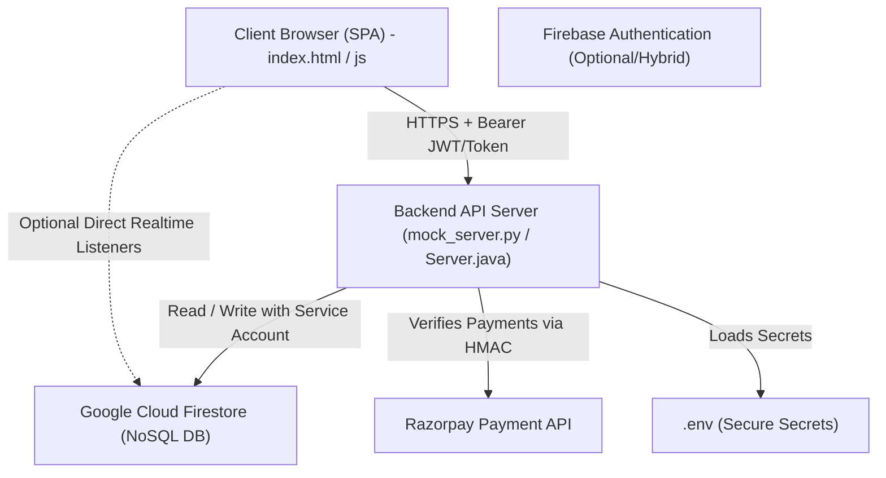
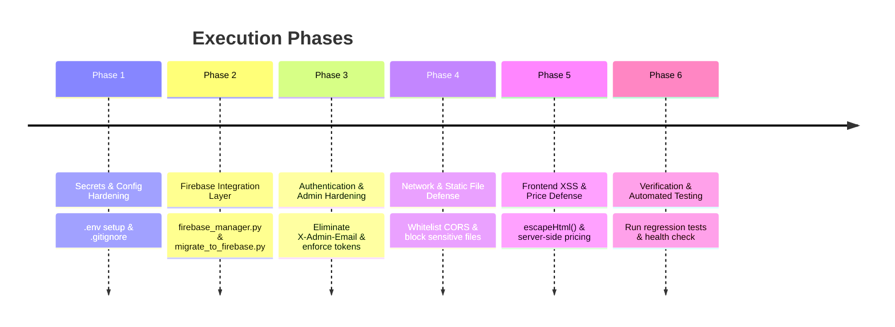

# 🛡️ Sai Sankalp: Security Hardening & Firebase Database Migration Plan

> **Goal**: Remediate all critical, high, and medium security vulnerabilities identified in the audit and transition the data persistence layer from local SQLite/MySQL/JSON to **Google Firebase (Cloud Firestore)**.
> **Status**: 📋 Planning Phase — Awaiting User Approval to Proceed.

---

## 🏗️ 1. Architecture Overview

### Why Backend-Mediated Firebase (Firestore + Firebase Admin SDK)?
1. **Zero Secret Leaks**: Firebase service account keys and Razorpay secrets stay strictly on the server.
2. **Business Rule Enforcement**: Inventory checks, stock decrement, price calculations, and coupon limits cannot be tampered with by client browsers.
3. **Seamless Transition**: Existing REST endpoints (`/api/products`, `/api/orders`, `/api/auth/*`) remain stable for the frontend while switching data storage under the hood.
4. **Data Portability**: Allows a one-click migration script to upload existing products, categories, coupons, and orders into Firestore.

---

## 🔒 2. Vulnerability Remediation Breakdown

### Phase A: Secrets & Environment Management (Critical)
| Item | Current Issue | Remediation | Files Impacted |
| :--- | :--- | :--- | :--- |
| **A1** | Hardcoded Razorpay key secret (`mock_server.py`: line 1287) | Move to `.env` as `RAZORPAY_KEY_ID` & `RAZORPAY_KEY_SECRET`. Load dynamically via `os.environ`. | [`mock_server.py`](file:///c:/Users/desai/Downloads/sai%20sankalp%20files/sai%20sankalp%20files/sai_sankalp_website/mock_server.py) |
| **A2** | Plaintext fallback MySQL password (`db_config.py`: line 19) | Remove hardcoded password; require `.env` or secure prompt. | [`db_config.py`](file:///c:/Users/desai/Downloads/sai%20sankalp%20files/sai%20sankalp%20files/sai_sankalp_website/db_config.py) |
| **A3** | SMTP credentials in plaintext config | Move email sender & app password to `.env`. | [`config.properties`](file:///c:/Users/desai/Downloads/sai%20sankalp%20files/sai%20sankalp%20files/sai_sankalp_website/config.properties) |
| **A4** | Git exposure risk | Add `.gitignore` to safeguard `.env`, `serviceAccountKey.json`, `*.db`, `*.csv`, `__pycache__`, and logs. | `.gitignore` (New) |

---

### Phase B: Authentication, Authorization & Session Security (Critical)
| Item | Current Issue | Remediation | Files Impacted |
| :--- | :--- | :--- | :--- |
| **B1** | **Admin Bypass via Header**: Anyone sending `X-Admin-Email: saisameermarla@gmail.com` gains admin powers in `Server.java`. | Completely remove `X-Admin-Email` trust. Authenticate strictly via cryptographic session tokens (`Authorization: Bearer <token>`). Validate `role == 'admin'` against server-side session/Firestore. | [`Server.java`](file:///c:/Users/desai/Downloads/sai%20sankalp%20files/sai%20sankalp%20files/sai_sankalp_website/Server.java), [`js/admin.js`](file:///c:/Users/desai/Downloads/sai%20sankalp%20files/sai%20sankalp%20files/sai_sankalp_website/js/admin.js), [`js/state.js`](file:///c:/Users/desai/Downloads/sai%20sankalp%20files/sai%20sankalp%20files/sai_sankalp_website/js/state.js), [`app.js`](file:///c:/Users/desai/Downloads/sai%20sankalp%20files/sai%20sankalp%20files/sai_sankalp_website/app.js) |
| **B2** | Unsalted SHA-256 passwords in `Server.java`. | Implement salted password hashing (Bcrypt / PBKDF2 with 10,000+ iterations + unique salt per user). | [`Server.java`](file:///c:/Users/desai/Downloads/sai%20sankalp%20files/sai%20sankalp%20files/sai_sankalp_website/Server.java) |
| **B3** | Predictable session tokens or localStorage exposure. | Ensure sessions use cryptographically secure random 256-bit hex tokens (`secrets.token_hex(32)`) with explicit expiration timestamps (e.g., 24 hours). | [`mock_server.py`](file:///c:/Users/desai/Downloads/sai%20sankalp%20files/sai%20sankalp%20files/sai_sankalp_website/mock_server.py), [`Server.java`](file:///c:/Users/desai/Downloads/sai%20sankalp%20files/sai%20sankalp%20files/sai_sankalp_website/Server.java) |

---

### Phase C: Transport, Access Control & Network Hardening (High)
| Item | Current Issue | Remediation | Files Impacted |
| :--- | :--- | :--- | :--- |
| **C1** | Wildcard CORS (`Access-Control-Allow-Origin: *`) on both servers. | Restrict CORS to explicitly allowed domains (`http://localhost:8000`, `http://127.0.0.1:8000`, and domain in `.env`). Reject untrusted origins. | [`mock_server.py`](file:///c:/Users/desai/Downloads/sai%20sankalp%20files/sai%20sankalp%20files/sai_sankalp_website/mock_server.py), [`Server.java`](file:///c:/Users/desai/Downloads/sai%20sankalp%20files/sai%20sankalp%20files/sai_sankalp_website/Server.java) |
| **C2** | Directory traversal & sensitive file downloads via static handler. | Add a strict static path whitelist: block direct web requests to `.env`, `*.db`, `*.csv`, `*.json`, `*.java`, `*.py`, `*.properties`, `__pycache__`. Serve only safe assets (`.html`, `.css`, `.js`, `.png`, `.jpg`, `.svg`, `.webp`, `.ico`). | [`mock_server.py`](file:///c:/Users/desai/Downloads/sai%20sankalp%20files/sai%20sankalp%20files/sai_sankalp_website/mock_server.py), [`Server.java`](file:///c:/Users/desai/Downloads/sai%20sankalp%20files/sai%20sankalp%20files/sai_sankalp_website/Server.java) |
| **C3** | Brute force attacks on auth endpoints. | Harden login rate limits (max 5 failed attempts per IP/email before 15-minute cooldown) and register rate limits. | [`mock_server.py`](file:///c:/Users/desai/Downloads/sai%20sankalp%20files/sai%20sankalp%20files/sai_sankalp_website/mock_server.py) |

---

### Phase D: Application Logic, XSS & Payment Integrity (Medium/High)
| Item | Current Issue | Remediation | Files Impacted |
| :--- | :--- | :--- | :--- |
| **D1** | Stored & Reflected XSS in frontend template literals. | Implement `escapeHtml()` utility; sanitize user inputs (customer names, reviews, search terms, addresses) before inserting into `innerHTML`. | [`js/state.js`](file:///c:/Users/desai/Downloads/sai%20sankalp%20files/sai%20sankalp%20files/sai_sankalp_website/js/state.js), [`js/storefront.js`](file:///c:/Users/desai/Downloads/sai%20sankalp%20files/sai%20sankalp%20files/sai_sankalp_website/js/storefront.js), [`js/admin.js`](file:///c:/Users/desai/Downloads/sai%20sankalp%20files/sai%20sankalp%20files/sai_sankalp_website/js/admin.js), [`app.js`](file:///c:/Users/desai/Downloads/sai%20sankalp%20files/sai%20sankalp%20files/sai_sankalp_website/app.js) |
| **D2** | Client-side price tampering risk. | Server recalculates order total from database product prices before saving order or creating Razorpay order. | [`mock_server.py`](file:///c:/Users/desai/Downloads/sai%20sankalp%20files/sai%20sankalp%20files/sai_sankalp_website/mock_server.py) |
| **D3** | Razorpay signature verification timing attack. | Ensure HMAC verification strictly uses `hmac.compare_digest` to prevent timing attacks. | [`mock_server.py`](file:///c:/Users/desai/Downloads/sai%20sankalp%20files/sai%20sankalp%20files/sai_sankalp_website/mock_server.py) |

---

## 📦 3. Firebase Database Migration Plan

### 3.1 Collections & Document Architecture in Cloud Firestore
We will establish 7 dedicated collections in Firestore matching Sai Sankalp's e-commerce models:

1. **`products`**:
   - `id`: string (e.g. `"prod_001"`)
   - `title`: string
   - `category`: string
   - `price`: number
   - `original_price`: number
   - `stock`: number
   - `in_stock`: boolean
   - `rating`: number
   - `image`: string
   - `badge`: string
   - `description`: string
   - `reviews`: array of `{ user, rating, comment, date }`
   - `updated_at`: timestamp

2. **`categories`**:
   - `id`: string
   - `name`: string
   - `icon`: string

3. **`banners`**:
   - `id`: string
   - `title`: string
   - `subtitle`: string
   - `image`: string
   - `link`: string
   - `active`: boolean

4. **`coupons`**:
   - `code`: string (uppercase)
   - `discount_type`: `"percentage"` | `"fixed"`
   - `discount_value`: number
   - `min_order_value`: number
   - `max_discount`: number
   - `active`: boolean
   - `expiry_date`: string

5. **`orders`**:
   - `order_id`: string (e.g. `"SS-ORD-1001"`)
   - `user_email`: string
   - `items`: array of `{ product_id, title, price, quantity, image }`
   - `subtotal`: number
   - `discount`: number
   - `shipping`: number
   - `total_amount`: number
   - `shipping_address`: map (name, phone, address, city, state, pincode)
   - `payment_method`: `"Razorpay"` | `"UPI"` | `"COD"`
   - `payment_status`: `"Pending"` | `"Paid"` | `"Failed"`
   - `order_status`: `"Confirmed"` | `"Processing"` | `"Shipped"` | `"Delivered"` | `"Cancelled"`
   - `tracking_number`: string
   - `created_at`: timestamp

6. **`users`**:
   - `email`: string (document ID or field)
   - `name`: string
   - `phone`: string
   - `password_hash`: string (Bcrypt)
   - `role`: `"admin"` | `"customer"`
   - `created_at`: timestamp

7. **`razorpay_logs`**:
   - Audit trail for payment orders and verification tokens.

---

### 3.2 Firebase Implementation Strategy
We will create a modular persistence layer:
1. **`firebase_manager.py`**:
   - Initializes Firebase Admin SDK with credentials from environment variables (`FIREBASE_CREDENTIALS_PATH` or inline JSON).
   - Provides CRUD methods for all collections: `get_products()`, `save_product()`, `get_orders()`, `create_order()`, `get_user()`, `save_user()`, etc.
   - Provides a **graceful fallback mechanism**: If Firebase credentials are not yet supplied by the user, it seamlessly operates using local data while logging a clear notification on how to supply the Firebase credentials.
2. **`migrate_to_firebase.py`**:
   - An automated script that reads current SQLite database (`data/saisankalp.db`) and JSON files (`data/products.json`, `data/categories.json`, `data/coupons.json`, `data/banners.json`, `data/users.json`, `data/orders.csv`) and bulk-uploads them to Cloud Firestore.
3. **`firestore.rules`**:
   - Ready-to-deploy Firestore security rules governing read and write access.

---

## 🚀 4. Step-by-Step Implementation Roadmap

- **Step 1: Secrets & Environment Setup**
  - Create `.env.example` and `.env` loader.
  - Create `.gitignore` to protect sensitive files.
  - Refactor `mock_server.py`, `db_config.py`, and `config.properties` to read from environment variables.

- **Step 2: Firebase Manager & Migration Script**
  - Create `firebase_manager.py` implementing Firestore connectivity with clean CRUD abstractions.
  - Create `migrate_to_firebase.py` for one-command data seeding from local files to Firestore.
  - Update `mock_server.py` to route database operations through `firebase_manager`.

- **Step 3: Admin Authorization & Password Hardening**
  - Deprecate `X-Admin-Email` across frontend (`js/state.js`, `js/admin.js`, `app.js`) and backends (`mock_server.py`, `Server.java`).
  - Upgrade `Server.java` password hashing to salted hashes and token validation.

- **Step 4: CORS Whitelist & Static Asset Protection**
  - Restrict CORS headers to authorized origins.
  - Patch static file handlers to forbid downloading `.db`, `.properties`, `.env`, `.py`, `.java`, `.json`, `.csv`.

- **Step 5: Frontend XSS & Logic Hardening**
  - Add HTML escaping to product renders, search results, and review submissions.
  - Verify HMAC SHA-256 constant-time comparison on Razorpay webhooks.

- **Step 6: Testing & Regression Verification**
  - Run regression test suite (`regression_test.py`) adapted for secured headers.
  - Validate that products, cart, checkout, admin portal, and order tracking operate smoothly.

---

## ❓ 5. Decisions Needed Before We Start

1. **Firebase Project Setup**:
   - Do you already have a Firebase project created in the Firebase Console (with a `serviceAccountKey.json`), or would you like us to set up the code with the local fallback first so you can plug in your Firebase keys whenever you are ready?
2. **Java Server vs. Python Server**:
   - We will apply the security fixes to both, but for the Firebase database migration, our primary focus will be on the Python server (`mock_server.py` + `firebase-admin`). Is this aligned with your workflow?

---

> [!NOTE]
> No code modifications will be made until you review this plan and say **"Proceed"** or give your approval!
