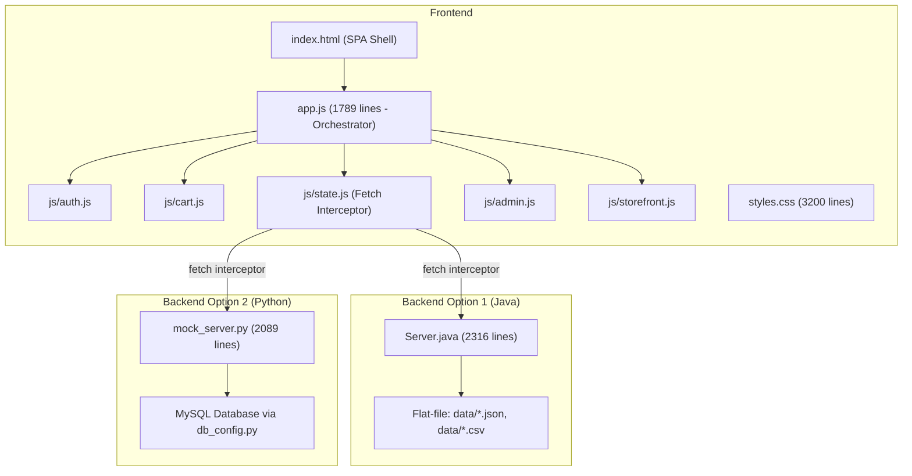

# 🔍 Sai Sankalp — Complete Audit Report

> **Project**: Sai Sankalp Crafts — Premium Handmade Decor E-Commerce Website
> **Audit Date**: October 2026
> **Auditor**: Antigravity AI
> **Scope**: Full-stack code audit — Backend (Java + Python), Frontend (HTML/CSS/JS), Data Layer, Security, Architecture

---

## Table of Contents

1. [Executive Summary](#executive-summary)
2. [Architecture Overview](#architecture-overview)
3. [🔴 Critical Security Findings](#critical-security-findings)
4. [🟠 High-Severity Issues](#high-severity-issues)
5. [🟡 Medium-Severity Issues](#medium-severity-issues)
6. [🔵 Low-Severity / Code Quality Issues](#low-severity--code-quality-issues)
7. [Frontend Audit](#frontend-audit)
8. [Backend Audit — Server.java](#backend-audit--serverjava)
9. [Backend Audit — mock_server.py](#backend-audit--mock_serverpy)
10. [Data Layer Audit](#data-layer-audit)
11. [Configuration & DevOps Audit](#configuration--devops-audit)
12. [Positive Observations](#positive-observations)
13. [Recommendation Summary Matrix](#recommendation-summary-matrix)

---

## Executive Summary

The **Sai Sankalp** project is a handcrafted goods e-commerce platform with **two** independent backend implementations:

| Backend | Language | Persistence | Maturity |
|---|---|---|---|
| [`Server.java`](file:///c:/Users/desai/Downloads/sai%20sankalp%20files/sai%20sankalp%20files/sai_sankalp_website/Server.java) | Java (com.sun.net.httpserver) | Flat-file JSON/CSV | Legacy / Prototype |
| [`mock_server.py`](file:///c:/Users/desai/Downloads/sai%20sankalp%20files/sai%20sankalp%20files/sai_sankalp_website/mock_server.py) | Python (http.server) | MySQL via `mysql.connector` | Production-ready |

The frontend is a **single-page application** served as static files with modular JavaScript.

Overall the project shows strong engineering intent (CSRF protection, rate limiting, OTP flows, bcrypt password upgrades), but has **several critical security vulnerabilities** and **architectural inconsistencies** that must be resolved before production deployment.

---

## Architecture Overview



---

## 🔴 Critical Security Findings

### CRIT-1: Hardcoded Razorpay Secret Key in Source Code

**File**: [`mock_server.py#L1287`](file:///c:/Users/desai/Downloads/sai%20sankalp%20files/sai%20sankalp%20files/sai_sankalp_website/mock_server.py#L1287)

```python
razorpay_secret = "eamlAYewc0PB3fUHcfj035uI"
```

> [!CAUTION]
> The Razorpay API secret key is **hardcoded** in the source file. Anyone with read access to this file (or the git repo) can impersonate payment verification, forge webhooks, or access the Razorpay dashboard.

**Fix**: Move to environment variable: `os.environ.get("RAZORPAY_SECRET")`.

---

### CRIT-2: Hardcoded Database Password in Source Code

**File**: [`db_config.py#L19`](file:///c:/Users/desai/Downloads/sai%20sankalp%20files/sai%20sankalp%20files/sai_sankalp_website/db_config.py#L19)

```python
"password": os.environ.get("MYSQL_PASSWORD", "NewPassword123!"),
```

> [!CAUTION]
> While the code reads from an env var, the **default fallback** exposes a real MySQL password. In development or if env vars aren't set, this password is used directly.

**Fix**: Remove the default password. Fail-fast if `MYSQL_PASSWORD` is not set.

---

### CRIT-3: Admin Bypass via Spoofable Header (Server.java)

**File**: [`Server.java#L1315-L1323`](file:///c:/Users/desai/Downloads/sai%20sankalp%20files/sai%20sankalp%20files/sai_sankalp_website/Server.java#L1315-L1323)

```java
private static boolean isAdmin(HttpExchange exchange) {
    SessionInfo session = getSession(exchange);
    if (session != null) {
        return "admin".equalsIgnoreCase(session.role);
    }
    // FALLBACK: accepts raw header as admin proof
    String adminHeader = exchange.getRequestHeaders().getFirst("X-Admin-Email");
    if (adminHeader == null) return false;
    adminHeader = adminHeader.trim().toLowerCase();
    return adminHeader.equals("saisameermarla@gmail.com") || adminHeader.equals("saisameermaral@gmail.com");
}
```

> [!CAUTION]
> **Any unauthenticated user** can gain admin access by simply sending `X-Admin-Email: saisameermarla@gmail.com` in their HTTP request header. This is a **complete authentication bypass** for all admin-protected endpoints (order status updates, product management, order deletion, etc.).

**Fix**: Remove the header-based fallback entirely. Require session-based authentication for admin.

---

### CRIT-4: Unsalted SHA-256 Password Hashing (Server.java)

**File**: [`Server.java#L1265-L1279`](file:///c:/Users/desai/Downloads/sai%20sankalp%20files/sai%20sankalp%20files/sai_sankalp_website/Server.java#L1265-L1279)

```java
private static String hashPassword(String password) {
    java.security.MessageDigest digest = java.security.MessageDigest.getInstance("SHA-256");
    byte[] hash = digest.digest(password.getBytes(StandardCharsets.UTF_8));
    // ...
}
```

> [!CAUTION]
> Passwords are hashed with **plain SHA-256** (no salt, no key-stretching). This is vulnerable to rainbow table attacks and brute force. The `users.json` file confirms passwords are stored as unsalted SHA-256 hashes.

**Evidence** — [`users.json`](file:///c:/Users/desai/Downloads/sai%20sankalp%20files/sai%20sankalp%20files/sai_sankalp_website/data/users.json):
```
"passwordHash": "240be518fabd2724ddb6f04eeb1da5967448d7e831c08c8fa822809f74c720a9"
```
This is the SHA-256 of `admin123` — trivially crackable.

**Fix**: Switch to bcrypt (as `mock_server.py` already does).

---

### CRIT-5: Wildcard CORS Policy (`Access-Control-Allow-Origin: *`)

**Files**: Both [`Server.java`](file:///c:/Users/desai/Downloads/sai%20sankalp%20files/sai%20sankalp%20files/sai_sankalp_website/Server.java) and [`mock_server.py`](file:///c:/Users/desai/Downloads/sai%20sankalp%20files/sai%20sankalp%20files/sai_sankalp_website/mock_server.py)

Every endpoint in both servers sets:
```
Access-Control-Allow-Origin: *
```

> [!WARNING]
> This allows **any website** on the internet to make authenticated API requests to your server. Combined with CRIT-3, a malicious website can fully control the admin panel.

**Fix**: Restrict to your actual domain(s) or use a whitelist approach.

---

### CRIT-6: Plaintext Password Stored in `users.json`

**File**: [`data/users.json`](file:///c:/Users/desai/Downloads/sai%20sankalp%20files/sai%20sankalp%20files/sai_sankalp_website/data/users.json)

All password hashes are unsalted SHA-256 and stored in a **plain text JSON file** on disk with no filesystem-level access control. Any file traversal vulnerability or misconfigured static file server would expose all user credentials.

---

## 🟠 High-Severity Issues

### HIGH-1: Race Conditions on File-Based Data Store (Server.java)

**File**: [`Server.java#L1425-L1451`](file:///c:/Users/desai/Downloads/sai%20sankalp%20files/sai%20sankalp%20files/sai_sankalp_website/Server.java#L1425-L1451)

The `saveToJson()` method reads the entire file, modifies it in-memory, and writes it back. With concurrent requests, this classic **read-modify-write** pattern causes:

- **Lost orders** — Two concurrent orders can overwrite each other
- **Data corruption** — File write may contain incomplete JSON

Only the user operations use `synchronized(USER_LOCK)`. Orders, products, and payments have **no locking**.

**Fix**: Add synchronization for all file operations, or migrate to a database.

---

### HIGH-2: No CSRF Protection (Server.java)

The Java `Server.java` has **zero CSRF protection**. There is no CSRF token generation, validation, or `SameSite` cookie configuration.

In contrast, `mock_server.py` correctly implements CSRF with `check_csrf()` and `X-CSRF-Token` header validation.

---

### HIGH-3: SQL Injection Risk — Mixed Syntax in mock_server.py

**File**: [`mock_server.py#L62`](file:///c:/Users/desai/Downloads/sai%20sankalp%20files/sai%20sankalp%20files/sai_sankalp_website/mock_server.py#L62)

```python
cursor.execute(f"CREATE DATABASE IF NOT EXISTS `{DATABASE_NAME}` ...")
```

While `DATABASE_NAME` comes from a config file, this is an f-string interpolation into SQL — a SQL injection vector if the config is ever externalized.

**Also**: The seed functions use `?` parameter placeholders (SQLite syntax), but the actual connector is `mysql.connector`, which uses `%s`. This would **crash at runtime** during data seeding.

```python
# Line 282 - SQLite syntax, not MySQL
cursor.execute("INSERT OR IGNORE INTO users ... VALUES (?, ?, ?, ?, ?)", ...)
```

---

### HIGH-4: Razorpay Signature Verification Bypass

**File**: [`mock_server.py#L1298`](file:///c:/Users/desai/Downloads/sai%20sankalp%20files/sai%20sankalp%20files/sai_sankalp_website/mock_server.py#L1298)

```python
if signature != expected_sig and signature != "simulated_valid_signature":
    verified = (signature == expected_sig)
```

> [!WARNING]
> Any attacker can bypass payment verification by sending `razorpay_signature: "simulated_valid_signature"` — this is a **hardcoded backdoor** in payment validation.

---

### HIGH-5: OTP Printed to Server Console with No Delivery

**Files**: [`Server.java#L1914-L1928`](file:///c:/Users/desai/Downloads/sai%20sankalp%20files/sai%20sankalp%20files/sai_sankalp_website/Server.java#L1914-L1928), [`mock_server.py#L994-L1007`](file:///c:/Users/desai/Downloads/sai%20sankalp%20files/sai%20sankalp%20files/sai_sankalp_website/mock_server.py#L994-L1007)

OTP codes for registration and password reset are **printed to stdout** but never actually sent via email or SMS. The email sending in `Server.java` only works if SMTP credentials are properly configured in `config.properties`, which defaults to placeholder values.

---

### HIGH-6: No Request Body Size Limit

**File**: [`Server.java#L1343-L1352`](file:///c:/Users/desai/Downloads/sai%20sankalp%20files/sai%20sankalp%20files/sai_sankalp_website/Server.java#L1343-L1352)

```java
private static String readRequestBody(HttpExchange exchange) throws IOException {
    InputStream is = exchange.getRequestBody();
    ByteArrayOutputStream bos = new ByteArrayOutputStream();
    byte[] buffer = new byte[1024];
    int len;
    while ((len = is.read(buffer)) != -1) {
        bos.write(buffer, 0, len);
    }
    return bos.toString("UTF-8");
}
```

No Content-Length validation or maximum body size check. An attacker can send a multi-GB request body to cause **OutOfMemoryError** (DoS).

---

## 🟡 Medium-Severity Issues

### MED-1: Dual Backend Architecture Confusion

The project ships **two completely independent backends** with different:
- Persistence layers (flat-file JSON/CSV vs MySQL)
- Security models (no CSRF vs CSRF)
- Password hashing (SHA-256 vs bcrypt)
- Feature sets (Server.java lacks customer-action, wishlist, addresses)

This creates confusion about which server is the production backend and leads to security inconsistencies.

---

### MED-2: Naive JSON Parser (Server.java)

**File**: [`Server.java#L1363-L1387`](file:///c:/Users/desai/Downloads/sai%20sankalp%20files/sai%20sankalp%20files/sai_sankalp_website/Server.java#L1363-L1387)

The `getJsonValue()` method uses `indexOf()` string searches to extract JSON values. This fails for:
- Nested objects with same key names
- Escaped quotes in values
- Boolean/null values
- Array values

---

### MED-3: Session Tokens Never Expire / Purged (Server.java)

Sessions in `Server.java` are stored in a `ConcurrentHashMap` with an `expires` timestamp, but expired sessions are **never cleaned up**. Over time, this causes unbounded memory growth. No logout endpoint exists to invalidate tokens.

---

### MED-4: Weak OTP Generation

**File**: [`Server.java#L1914`](file:///c:/Users/desai/Downloads/sai%20sankalp%20files/sai%20sankalp%20files/sai_sankalp_website/Server.java#L1914)

```java
String otpCode = String.valueOf((int)(100000 + Math.random() * 900000));
```

`Math.random()` is **not cryptographically secure**. OTPs should use `SecureRandom`.

---

### MED-5: Static File Handler Serves Sensitive Files

**File**: [`Server.java`](file:///c:/Users/desai/Downloads/sai%20sankalp%20files/sai%20sankalp%20files/sai_sankalp_website/Server.java)

The `StaticFileHandler` serves files from the project root (`.`). This means `config.properties`, `Server.java`, `db_config.py`, `data/users.json`, etc. are all **publicly downloadable** via the web server unless explicitly blocked.

Visiting `http://localhost:8080/data/users.json` would return all user credentials.
Visiting `http://localhost:8080/config.properties` would return SMTP credentials.

---

### MED-6: `INSERT OR IGNORE` / `INSERT OR REPLACE` (mock_server.py)

These are SQLite-specific SQL statements. The project uses `mysql.connector`, which does not support this syntax. This means:

- Data seeding will fail on MySQL
- Session management (`INSERT OR REPLACE INTO sessions`) will fail
- Payment records won't be stored properly

**Fix**: Use MySQL-compatible `INSERT ... ON DUPLICATE KEY UPDATE` syntax.

---

### MED-7: No Input Validation on Financial Fields

Order amounts (`subtotal`, `cgst`, `sgst`, `totalAmount`) are accepted directly from the client without server-side recalculation. A malicious client could submit:
```json
{"subtotal": 0.01, "totalAmount": 0.01, "items": [{"title":"₹1200 item","price":1200}]}
```

---

### MED-8: Hardcoded Admin Email Addresses

Multiple files contain hardcoded admin emails:
- [`Server.java#L1323`](file:///c:/Users/desai/Downloads/sai%20sankalp%20files/sai%20sankalp%20files/sai_sankalp_website/Server.java#L1323): `saisameermarla@gmail.com`, `saisameermaral@gmail.com`
- [`mock_server.py#L419`](file:///c:/Users/desai/Downloads/sai%20sankalp%20files/sai%20sankalp%20files/sai_sankalp_website/mock_server.py#L419): `ADMIN_EMAIL = "saisameermarla@gmail.com"`
- [`mock_server.py#L420`](file:///c:/Users/desai/Downloads/sai%20sankalp%20files/sai%20sankalp%20files/sai_sankalp_website/mock_server.py#L420): `ADMIN_CONTACT = "9361483584"`

---

## 🔵 Low-Severity / Code Quality Issues

### LOW-1: Mixed Database References in mock_server.py

The startup message says `SQLite (data/saisankalp.db)` but the actual backend is MySQL:
```python
print(f"  Database backend: SQLite (data/saisankalp.db)")  # Line 2081 — WRONG
```

---

### LOW-2: Inconsistent Error Codes

`mock_server.py` returns HTTP `444` for unmatched routes — this is an NGINX-specific code and non-standard. Should be `404`.

---

### LOW-3: Product Specs Lost in mock_server.py Migration

When products are fetched from MySQL in `mock_server.py`, `specs` is hardcoded to `{"Material": "Handmade Craft", "Care": "Handle with love"}` rather than being stored/retrieved from the database.

---

### LOW-4: No Pagination on List Endpoints

Both `/api/orders` and `/api/products` return all records. With growth, this becomes a performance and bandwidth issue.

---

### LOW-5: `app.js` Monolith (1789 lines)

The main frontend file handles routing, rendering, event binding, animations, and business logic all in one file. Consider splitting by feature.

---

### LOW-6: CSS Custom Properties Not Fully Utilized

`styles.css` defines some CSS variables but frequently uses hardcoded color values throughout the 3200-line file, making theme changes difficult.

---

## Frontend Audit

### Files Reviewed

| File | Lines | Purpose |
|---|---|---|
| [`index.html`](file:///c:/Users/desai/Downloads/sai%20sankalp%20files/sai%20sankalp%20files/sai_sankalp_website/index.html) | ~340 | SPA shell, script imports, Razorpay SDK |
| [`app.js`](file:///c:/Users/desai/Downloads/sai%20sankalp%20files/sai%20sankalp%20files/sai_sankalp_website/app.js) | 1789 | Main orchestrator |
| [`js/auth.js`](file:///c:/Users/desai/Downloads/sai%20sankalp%20files/sai%20sankalp%20files/sai_sankalp_website/js/auth.js) | 243 | Auth flows (login, register, OTP, forgot password) |
| [`js/cart.js`](file:///c:/Users/desai/Downloads/sai%20sankalp%20files/sai%20sankalp%20files/sai_sankalp_website/js/cart.js) | 209 | Cart + coupon logic |
| [`js/state.js`](file:///c:/Users/desai/Downloads/sai%20sankalp%20files/sai%20sankalp%20files/sai_sankalp_website/js/state.js) | 57 | Global state + fetch interceptor |
| [`js/admin.js`](file:///c:/Users/desai/Downloads/sai%20sankalp%20files/sai%20sankalp%20files/sai_sankalp_website/js/admin.js) | 1056 | Admin dashboard |
| [`js/storefront.js`](file:///c:/Users/desai/Downloads/sai%20sankalp%20files/sai%20sankalp%20files/sai_sankalp_website/js/storefront.js) | 256 | Wishlist, compare, banners |
| [`styles.css`](file:///c:/Users/desai/Downloads/sai%20sankalp%20files/sai%20sankalp%20files/sai_sankalp_website/styles.css) | 3200 | All styles |
| [`payment_gateway.html`](file:///c:/Users/desai/Downloads/sai%20sankalp%20files/sai%20sankalp%20files/sai_sankalp_website/payment_gateway.html) | ~350 | Payment gateway simulator |

### Frontend Findings

| # | Finding | Severity |
|---|---|---|
| FE-1 | `state.js` stores session token in `localStorage` — vulnerable to XSS token theft | 🟠 High |
| FE-2 | No Content Security Policy (CSP) headers served | 🟡 Medium |
| FE-3 | Razorpay test key `rzp_test_T8XwugnuJ4Wtkm` is hardcoded in HTML/JS | 🟡 Medium |
| FE-4 | Client-side price/tax calculations not re-verified server-side | 🟠 High |
| FE-5 | Cart data in `localStorage` can be tampered to alter checkout amounts | 🟡 Medium |
| FE-6 | No lazy-loading of product images | 🔵 Low |
| FE-7 | Admin panel accessible via client-side JS routing check only (no server redirect protection) | 🟠 High |

---

## Backend Audit — Server.java

### Summary

| Metric | Value |
|---|---|
| Lines of Code | 2,316 |
| Endpoints | ~15 |
| Auth Model | Session (UUID) + Header bypass |
| Persistence | Flat JSON/CSV files |
| Concurrency Safety | ❌ Partial (only users) |
| CSRF Protection | ❌ None |
| Password Security | ❌ Unsalted SHA-256 |
| Input Sanitization | Basic HTML tag stripping |

### Specific Issues

| # | Issue | Line(s) | Impact |
|---|---|---|---|
| SJ-1 | Admin header bypass (CRIT-3) | 1315-1323 | Full admin access without auth |
| SJ-2 | Unsalted SHA-256 (CRIT-4) | 1265-1279 | Password cracking |
| SJ-3 | File race conditions (HIGH-1) | 1425-1451 | Data loss |
| SJ-4 | No body size limit (HIGH-6) | 1343-1352 | DoS via memory exhaustion |
| SJ-5 | Static file serves sensitive data (MED-5) | ~200+ | Credential leaks |
| SJ-6 | OTP via `Math.random()` (MED-4) | 1914 | Predictable OTPs |
| SJ-7 | No session cleanup | 76-80 | Memory leak |
| SJ-8 | Hand-rolled SMTP client | 1763-1848 | Fragile, no TLS cert validation |
| SJ-9 | Emoji in SMTP subject lines | 1223 | May cause encoding issues |
| SJ-10 | No HTTPS enforcement | Throughout | Man-in-the-middle risk |

---

## Backend Audit — mock_server.py

### Summary

| Metric | Value |
|---|---|
| Lines of Code | 2,089 |
| Endpoints | ~25 |
| Auth Model | Session (UUID + Cookie) + CSRF |
| Persistence | MySQL (via mysql.connector) |
| Password Security | ✅ bcrypt (with legacy migration) |
| Input Sanitization | ✅ `html.escape()` |
| CSRF Protection | ✅ Present |
| Concurrency | Thread-safe via MySQL |

### Specific Issues

| # | Issue | Line(s) | Impact |
|---|---|---|---|
| MP-1 | Hardcoded Razorpay secret (CRIT-1) | 1287 | Full payment compromise |
| MP-2 | Simulated signature bypass (HIGH-4) | 1298 | Payment fraud |
| MP-3 | SQLite syntax in MySQL connector (MED-6) | 282, 302, etc. | Runtime crashes |
| MP-4 | Misleading startup message (LOW-1) | 2081 | Confusion |
| MP-5 | No `cursor.close()` in several handlers | Throughout | Resource leaks |
| MP-6 | `dict(cursor)` requires `cursor_class=MySQLCursorDict` config | Throughout | Potential AttributeError |
| MP-7 | Webhook secret as env var with hardcoded default | 1695 | Key exposure |
| MP-8 | File upload path traversal potential | 1800-1825 | Arbitrary file write |

---

## Data Layer Audit

### Files

| File | Purpose | Risk |
|---|---|---|
| [`data/users.json`](file:///c:/Users/desai/Downloads/sai%20sankalp%20files/sai%20sankalp%20files/sai_sankalp_website/data/users.json) | User credentials (SHA-256 hashed) | 🔴 Publicly accessible |
| [`data/products.json`](file:///c:/Users/desai/Downloads/sai%20sankalp%20files/sai%20sankalp%20files/sai_sankalp_website/data/products.json) | Product catalog | 🟢 Acceptable |
| [`data/orders.json`](file:///c:/Users/desai/Downloads/sai%20sankalp%20files/sai%20sankalp%20files/sai_sankalp_website/data/orders.json) | Order history with PII | 🔴 Contains customer data |
| [`data/orders.csv`](file:///c:/Users/desai/Downloads/sai%20sankalp%20files/sai%20sankalp%20files/sai_sankalp_website/data/orders.csv) | CSV mirror of orders | 🔴 Contains customer data |
| [`config.properties`](file:///c:/Users/desai/Downloads/sai%20sankalp%20files/sai%20sankalp%20files/sai_sankalp_website/config.properties) | SMTP credentials | 🔴 Credential file in webroot |
| [`db_config.py`](file:///c:/Users/desai/Downloads/sai%20sankalp%20files/sai%20sankalp%20files/sai_sankalp_website/db_config.py) | MySQL credentials | 🔴 Default password exposed |

> [!IMPORTANT]
> The `data/` directory and `config.properties` file are inside the web server's static file root. They are **directly downloadable** by any visitor.

---

## Configuration & DevOps Audit

| Check | Status | Notes |
|---|---|---|
| HTTPS | ❌ | Only `mock_server.py` has production redirect logic |
| Environment Variables | ⚠️ Partial | Some configs have hardcoded defaults |
| `.gitignore` | ❓ Not found | Secrets likely committed to VCS |
| Logging | ❌ | Only `System.out.println` / `print()` |
| Error Handling | ⚠️ | Stack traces may leak in 500 responses |
| Dependency Management | ❌ | No `pom.xml`, `requirements.txt`, or `package.json` |
| Testing | ❌ | No unit or integration tests found |
| CI/CD | ❌ | No pipeline configuration found |
| Rate Limiting | ✅ | 60 req/min/IP on both backends |
| Monitoring | ❌ | No health check endpoints |

---

## Positive Observations

Despite the critical issues, the project demonstrates several **strong engineering decisions**:

| ✅ Strength | Details |
|---|---|
| **Rate Limiting** | Both backends enforce 60 req/min/IP |
| **Login Attempt Lockout** | `mock_server.py` locks accounts after 5 failed attempts for 15 min |
| **bcrypt Password Migration** | `mock_server.py` auto-upgrades legacy SHA-256 hashes to bcrypt on login |
| **CSRF Tokens** | `mock_server.py` generates and validates CSRF tokens per session |
| **Test/Sandbox Mode** | Both backends support a test mode via `X-Test-Mode` header for safe testing |
| **Inventory Management** | Stock is checked and decremented atomically; restocked on cancellation |
| **Order Lifecycle** | Full status pipeline: Pending → Confirmed → Processing → Shipped → Delivered |
| **Email Templates** | Well-structured HTML email templates with branded styling |
| **XSS Prevention** | `mock_server.py` sanitizes all input with `html.escape()` |
| **HttpOnly + SameSite Cookies** | `mock_server.py` sets secure cookie attributes |
| **Double-checkout Prevention** | Transaction ID uniqueness check prevents replay attacks |
| **Amount Mismatch Detection** | Order creation verifies paid amount matches expected total |

---

## Recommendation Summary Matrix

| Priority | Issue | Fix |
|---|---|---|
| 🔴 **P0** | Razorpay secret in source code | Move to env var, rotate key immediately |
| 🔴 **P0** | Admin header bypass in Server.java | Remove `X-Admin-Email` fallback |
| 🔴 **P0** | Sensitive files in webroot | Block `/data/`, `/config.properties`, `*.java`, `*.py` from static serving |
| 🔴 **P0** | Unsalted SHA-256 passwords | Migrate Server.java to bcrypt; force password reset for existing users |
| 🔴 **P0** | Wildcard CORS | Restrict to actual domain(s) |
| 🔴 **P0** | Simulated signature bypass | Remove `"simulated_valid_signature"` check |
| 🟠 **P1** | File race conditions | Add synchronization or migrate to DB |
| 🟠 **P1** | No CSRF on Server.java | Add CSRF token flow |
| 🟠 **P1** | SQLite syntax in MySQL driver | Replace `?` with `%s`, `INSERT OR IGNORE` with `INSERT IGNORE` |
| 🟠 **P1** | No request body size limit | Add Content-Length cap (e.g., 1MB) |
| 🟠 **P1** | Server-side price validation | Recalculate totals from product catalog prices |
| 🟡 **P2** | Unify to one backend | Deprecate Server.java; use mock_server.py as sole backend |
| 🟡 **P2** | Add `.gitignore` | Exclude `data/`, `config.properties`, `db_config.py` |
| 🟡 **P2** | Add `requirements.txt` | Pin dependencies: `mysql-connector-python`, `bcrypt` |
| 🟡 **P2** | Add CSP headers | Prevent XSS via `Content-Security-Policy` |
| 🟡 **P2** | Session token in cookies, not localStorage | Prevent XSS-based session theft |
| 🔵 **P3** | Add pagination | Prevent large responses on list endpoints |
| 🔵 **P3** | Refactor `app.js` | Split into feature modules |
| 🔵 **P3** | Add unit tests | Cover auth, payment, and order flows |
| 🔵 **P3** | Fix misleading startup message | Change "SQLite" to "MySQL" |

---

> [!NOTE]
> This audit is based on static code analysis. A live penetration test would likely reveal additional issues, especially around the payment gateway integration and session management.

---

*End of Audit Report*
